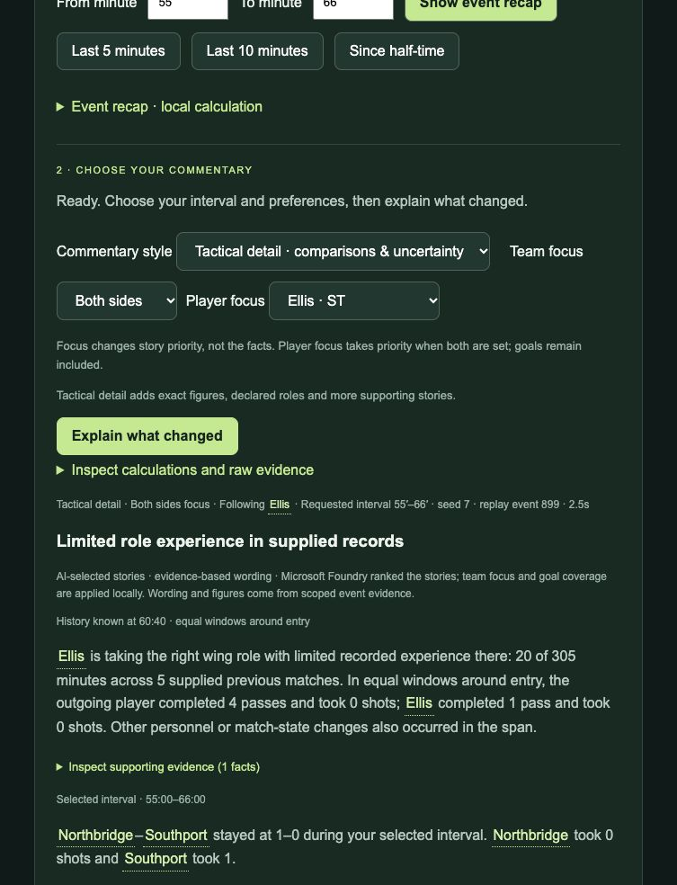

# Touchline — Your AI Co-commentator

**Missed ten minutes? Catch up on the story, not just the score.** Touchline is a football companion for a returning fan: choose a match interval, follow a team or player, and inspect the evidence behind a short explanation.

[Open the public demo](https://touchline-fan-20261025-b4bpgfdxbyarhyh5.germanywestcentral-01.azurewebsites.net/) · [Watch the 1:48 narrated video](https://youtu.be/9JvQMpAhdpA) · [Full user guide](docs/USER_GUIDE.md) · [Judge testing instructions](TESTING_INSTRUCTIONS.md)

The demo uses entirely fictional matches. You do not need an account, a payment, your own data or an Azure subscription to try the hosted website. Free hosting can take a little time to start.



## Your first explanation: about one minute

1. Open the public demo and select **Try the substitution example**. This prepares seed 7 at minute 66, selects minutes 55–66, Tactical detail and Ellis. It does not make a model request yet.
2. Select **Explain what changed**. The explanation should connect Ellis's assigned wing role with his supplied history: only **20 of 305 previous recorded minutes** in that role. This describes familiarity in the sample, not his ability or the substitution's causal effect.
3. Open **Inspect supporting evidence** beneath a story. Check the event/history IDs, timestamps and comparison window. **Explore the play behind this explanation** provides the underlying analysis.
4. Select **Quick catch-up** and explain again. Expect shorter wording. Select a team or player to change relevance; important goals and dismissals remain included.
5. Change the interval or replay position. An older explanation is flagged; request a new one for the new selection. You cannot request minutes the replay has not revealed.

Foundry can rank supporting stories differently. If online selection is unavailable, a clearly labelled local fallback still gives supported commentary.

## What you can do

| Your question or task | Where to go | What you get |
|---|---|---|
| What did I miss between two minutes? | **Catch up on the story** → From/To → **Explain what changed** | Selected-interval commentary, supporting facts and a next-to-watch question; full time uses a replay takeaway. |
| Give me just the events | **Show event recap** | A local summary; no model call is needed. |
| Why is this substitution interesting? | Prepared substitution example; **Tactical detail**, player focus | Usual/assigned roles, supplied recent role minutes, involvement comparisons and concurrent changes. |
| Who is playing, and where? | **Teams & lineups** → player details | Starting/current XI, bench, fictional manager, declared formation and player roles. **Follow this player in commentary** sets player focus. |
| How do I say this football term in another language? | **Glossary language** → click an underlined term/name | Curated translation and explanation in Chinese, Spanish, French, German, Portuguese or Japanese. The interface and commentary remain English. |
| Can I inspect another synthetic match? | **Match data & demo settings** | Change the seed, generate a replay, load the example, upload a supported JSON package or download the current package. |
| What is known about a reported incident? | Example package → replay through minutes 33 and 34 | A report and later clarification, with an official-rule reference kept separate from the incident facts. |

The pitch markers show declared lineup slots, not tracked player movement. Statistics include score, possession, shots/on target, passes/completion, fouls, cards, corners and substitutions. **The local refinement adds supplied/illustrative shot values with provenance, coverage and a chart; these are not calibrated professional xG.**

## Bring your own input

Upload **Touchline synthetic package JSON v1**, not an arbitrary provider export or a video. Start from [the runnable example](data/example-match-package.json), or download a current package from the website. A JSON file is a structured text document containing named fields, lists and records.

Required content: match metadata, provenance, two squads and chronological core events covering 0–90 minutes. Optional role-history records and incident annotations enrich the explanation. A narrative cannot reliably supply context missing from the input.

The website validates the package before using it. The current limits are 2 MB, 12,000 core events, 200 annotations and 1,000 history records; up to eight uploaded packages are held in server memory for one hour. A server restart clears uploads. Do not upload sensitive information. **CSV, live feeds, real video and open-ended online match lookup are not supported.** See [input specification](docs/MATCH_PACKAGE.md) and [step-by-step upload instructions](docs/USER_GUIDE.md#bring-your-own-synthetic-match).

## What the AI does

```text
Synthetic events + optional supplied history/incident records
  → validate and time-filter
  → calculate statistics, sequences and comparison windows
  → retrieve available role history and build supported story candidates
  → Microsoft Foundry ranks candidate IDs
  → apply focus and essential-event coverage
  → render evidence-owned wording and source links
```

The hosted model is **gpt-5-mini through Microsoft Foundry**. Azure App Service hosts the website and private Node backend. The hosted release selects among supported stories. The local Batch 5 refinement also supports bounded, model-selected evidence queries and follow-ups; final wording stays tied to inspected source-owned stories. Neither path browses the web or writes unrestricted commentary. Calculations and displayed story wording are deterministic. The selected evidence packet is sent to Foundry only when online commentary is requested; it is not an offline-only product.

Caching, persistent call allowances, request throttling and local fallback protect the student-credit demo. The local calculation/replay path works without Azure credentials. [Architecture](docs/ARCHITECTURE.md) · [Data provenance](docs/DATA_PROVENANCE.md) · [Scope and limits](docs/FINAL_SCOPE.md)

## Run locally

Requires **Node.js 22 or newer**; no runtime dependencies need installing.

```sh
git clone https://github.com/JialeiLuo/touchline.git
cd touchline
npm start
```

Open `http://127.0.0.1:8767/`. Without Azure configuration, commentary uses the labelled local fallback. For online ranking, copy `.env.example` to `.env` and privately configure your own Foundry deployment. Never commit `.env` or share API keys. The hosted demo's configuration is not distributed.

## Evidence, evaluation and judging coverage

```sh
npm test
npm run evaluate
node tools/evaluate-product.cjs
```

Recorded evaluation: **19 test files**, a **288-combination deterministic contract matrix**, **five controlled history variants**, and **eight fresh live-ranking samples**. These check different things; their counts are not comparable units and do not establish a fan-usefulness score. Live evaluation scripts consume model credit and are optional. [Results and limits](docs/PRODUCT_EVALUATION.md)

[Criterion-by-criterion review and complete idea coverage](docs/COVERAGE_REVIEW.md) identifies the strongest evidence and the remaining gaps. The local Batch 5 refinement implements bounded investigation; its broader reliability and incremental value still need comparative evaluation. Independent testing with fans remains a validation gap. Novelty and superiority over other assistants have not been established.

## Project documentation

- [User guide](docs/USER_GUIDE.md) and [judge testing instructions](TESTING_INSTRUCTIONS.md)
- [Submission pitch](SUBMISSION.md), [video and reproduction](submission/VIDEO.md)
- [Coverage review and next steps](docs/COVERAGE_REVIEW.md), [living brainstorm](docs/IDEAS.md)
- [Architecture](docs/ARCHITECTURE.md), [input contract](docs/MATCH_PACKAGE.md), [synthetic provenance](docs/DATA_PROVENANCE.md)
- [Product evaluation](docs/PRODUCT_EVALUATION.md), [context evaluation](docs/CONTEXT_EVALUATION.md), [frozen scope](docs/FINAL_SCOPE.md)
- [Public deployment](docs/PUBLIC_DEMO.md), [copyright and licensing position](COPYRIGHT.md)

No real football feed, video perception, calibrated xG, match prediction, broad injury/manager/recruitment history, arbitrary CSV import or production-scale service is included. The narrated demonstration video is not a voice-commentary feature inside the website.

### Local refinement: reliable match input
Batch 1 adds data-based upload analysis (including possession sequences), explicit time/coordinate contracts, capability labels, event-specific validation errors, atomic package replacement and expiry/removal controls. Open **Match data & demo settings** to load or download an example. See [input contract](docs/MATCH_PACKAGE.md), [viewer instructions](docs/USER_GUIDE.md) and [Batch 1 verification](docs/BATCH_1.md). These local refinements are not yet deployed to the public submission demo.

## Local refinement evaluation

Batch 2 adds a controlled [scenario matrix and baseline protocol](docs/EVALUATION_SCENARIOS.md). Run `npm run evaluate:scenarios` for development cases; the reserved split is separate. See [Batch 2 results and limitations](docs/BATCH_2.md). These offline checks do not establish model superiority or fan usefulness.

Batch 3 adds [richer football evidence tools](docs/FOOTBALL_EVIDENCE_TOOLS.md), including actual player exposure, progression denominators, declared-shape and discipline context. See [verification and local viewer changes](docs/BATCH_3.md).

Batch 4 adds [supplied/illustrative chance quality](docs/CHANCE_QUALITY.md). See [local verification and limitations](docs/BATCH_4.md). The hosted demo and video update in the final release batches.

Batch 5 adds the [bounded AI investigator](docs/BOUNDED_INVESTIGATOR.md), with model-selected queries, follow-ups, inspected-story gating, budgets and a visible trace. See [local results and live samples](docs/BATCH_5.md). Publication remains Batch 10.

Batch 6 adds [connected, grounded commentary](docs/GROUNDED_COMMENTARY.md): facts versus interpretation, checked claims, quiet/full-time handling and complementary composition. See [local verification and remaining limits](docs/BATCH_6.md).
